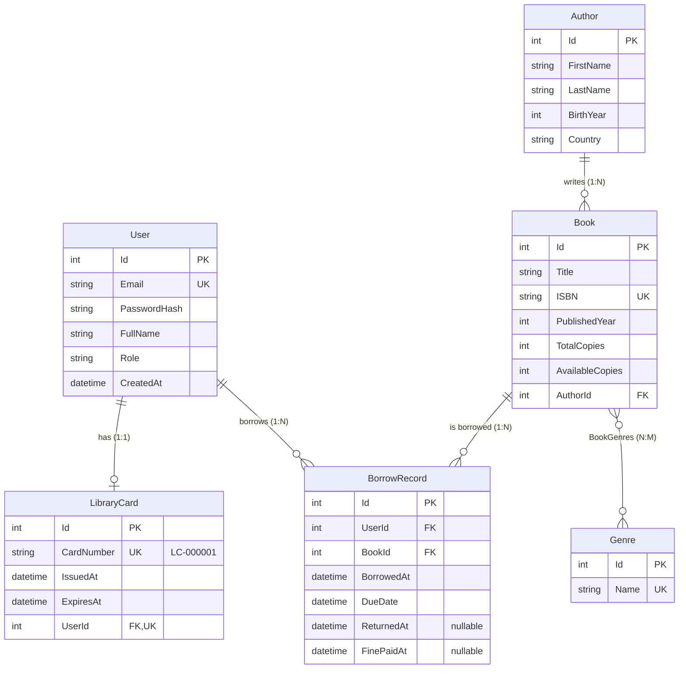

# Library Service API

ბიბლიოთეკის მართვის REST API: ASP.NET Core Web API (.NET 8), Entity Framework Core (Code First), JWT ავტორიზაცია, FluentValidation და AutoMapper.

ბიბლიოთეკარი (Librarian) მართავს ავტორებს, ჟანრებს და წიგნებს, ხედავს ყველა გაცემას და ვადაგადაცილებულებს და ხურავს ჯარიმებს. მკითხველი (Reader) ხსნის ბიბლიოთეკის ბარათს, ეძებს წიგნებს, იღებს და აბრუნებს მათ და ხედავს საკუთარი გაცემების ისტორიას.

---

## ტექნოლოგიები

| კომპონენტი | ტექნოლოგია |
|---|---|
| Framework | ASP.NET Core Web API (.NET 8), Controller-based |
| მონაცემთა ბაზა | SQL Server + Entity Framework Core 8 (Code First, მიგრაციები) |
| ავტორიზაცია | JWT Bearer (`Microsoft.AspNetCore.Authentication.JwtBearer`), როლებით |
| პაროლები | `BCrypt.Net-Next`: ბაზაში ინახება მხოლოდ ჰეში |
| ვალიდაცია | FluentValidation 12 (გლობალური `ValidationFilter`-ით) |
| მეფინგი | AutoMapper (Profile თითო მოდულზე) |
| დოკუმენტაცია | Swagger (Swashbuckle), Bearer ტოკენის მხარდაჭერით |

---

## გაშვება

### საჭიროა
- .NET 8 SDK
- SQL Server (ან SQL Server Express)
- EF Core CLI: `dotnet tool install --global dotnet-ef`

### 1. Connection string
`LibraryService/appsettings.json`:
```json
"ConnectionStrings": {
  "Database": "Server=localhost\\SQLEXPRESS;Database=LibraryServiceDb;Trusted_Connection=True;TrustServerCertificate=True;MultipleActiveResultSets=true"
}
```
სხვა სერვერის შემთხვევაში შეცვალე `Server=`.

JWT-ის პარამეტრები იმავე ფაილიდან იკითხება (`Jwt:Key`, `Jwt:Issuer`, `Jwt:Audience`). გასაღები მინიმუმ 32 სიმბოლოა.

### 2. ბაზის შექმნა
```bash
cd LibraryService
dotnet ef database update
```

### 3. გაშვება
```bash
dotnet run
```
Swagger: **http://localhost:5198/swagger**

საწყისი მონაცემები (seed) გაშვებისას ავტომატურად ემატება, თუ ბაზა ცარიელია (`Data/Seed/DbSeeder.cs`).

---

## Seed მომხმარებლები

| როლი | Email | პაროლი |
|---|---|---|
| Librarian | `librarian@library.ge` | `Librarian1` |
| Reader | `reader@library.ge` | `Reader123` |

ამასთან ერთად ემატება 6 ჟანრი, 3 ავტორი და 4 წიგნი. "Animal Farm" 1 ეგზემპლარითაა, რომ ადვილად შემოწმდეს წესი „ხელმისაწვდომი ეგზემპლარი არ არის“.

### Swagger-ში ავტორიზაცია
1. `POST /api/auth/login`: email და პაროლი ცხრილიდან.
2. დააკოპირე `accessToken`.
3. **Authorize** ღილაკი → ჩასვი ტოკენი (`Bearer ` სიტყვის გარეშე) → Authorize.

---

## როლები

როლი რეგისტრაციისას ირჩევა (`"role": "Reader"` ან `"role": "Librarian"`). ტოკენი შეიცავს `sub` (UserId), `email` და `role` claim-ებს, ვადა 8 საათია.

| როლი | შესაძლებლობები |
|---|---|
| **Librarian** | ავტორების, ჟანრების, წიგნების სრული მართვა; ყველა გაცემის ნახვა; ვადაგადაცილებულების სია; ჯარიმის დახურვა |
| **Reader** | საკუთარი ბარათის გახსნა; წიგნების ძებნა; წიგნის აღება და დაბრუნება; საკუთარი გაცემების ისტორია |

---

## ER დიაგრამა



### კავშირები და მათი კონფიგურაცია (Fluent API, `Data/Configurations/`)

| ტიპი | კავშირი | კონფიგურაცია |
|---|---|---|
| 1:1 | User ↔ LibraryCard | FK `LibraryCard.UserId` + unique index; Cascade |
| 1:N | Author → Book | `DeleteBehavior.Restrict`: ავტორი წიგნებით არ იშლება |
| 1:N | User → BorrowRecord, Book → BorrowRecord | Restrict: გაცემების ისტორია არ იკარგება |
| N:M | Book ↔ Genre | „სუფთა“ N:M, EF-ის ავტომატური join ცხრილი `BookGenres` |
| N:M | User ↔ Book (BorrowRecord-ით) | დამატებითი ველები აქვს (თარიღები), ამიტომ სრულფასოვანი ენთითია საკუთარი Id-ით |

---

## Endpoint-ები

| მეთოდი | მარშრუტი | წვდომა | აღწერა |
|---|---|---|---|
| POST | `/api/auth/register` | ღია | რეგისტრაცია (Reader ან Librarian) |
| POST | `/api/auth/login` | ღია | JWT ტოკენის მიღება |
| GET | `/api/authors?search=&page=&pageSize=` | Auth | ავტორების სია |
| GET | `/api/authors/{id}` | Auth | ავტორი წიგნების სიით |
| POST | `/api/authors` | Librarian | დამატება |
| PUT | `/api/authors/{id}` | Librarian | რედაქტირება |
| DELETE | `/api/authors/{id}` | Librarian | წაშლა (400, თუ წიგნები აქვს) |
| GET | `/api/genres` | Auth | ჟანრების სია |
| POST | `/api/genres` | Librarian | ჟანრის დამატება |
| GET | `/api/books?search=&authorId=&genreId=&availableOnly=&page=&pageSize=` | Auth | წიგნების სია ფილტრებით |
| GET | `/api/books/{id}` | Auth | წიგნი ავტორით და ჟანრებით |
| POST | `/api/books` | Librarian | დამატება (`genreIds[]`) |
| PUT | `/api/books/{id}` | Librarian | რედაქტირება, ჟანრების სრული ჩანაცვლებით |
| DELETE | `/api/books/{id}` | Librarian | წაშლა (400, თუ აქტიური გაცემა აქვს) |
| POST | `/api/library-cards` | Reader | საკუთარი ბარათის გახსნა (1 წლით) |
| GET | `/api/library-cards/me` | Reader | ჩემი ბარათი |
| POST | `/api/borrows` | Reader | წიგნის აღება: `{ "bookId": 5 }` |
| POST | `/api/borrows/{id}/return` | Reader | დაბრუნება (მხოლოდ საკუთარი) |
| GET | `/api/borrows/me?activeOnly=` | Reader | ჩემი გაცემები |
| GET | `/api/borrows?overdueOnly=&userId=` | Librarian | ყველა გაცემა |
| POST | `/api/fines/{borrowId}/pay` | Librarian | ჯარიმის დახურვა (ბონუსი) |

ყველა სია მხარს უჭერს pagination-ს. პასუხის ფორმატია `items`, `totalCount`, `page`, `pageSize`, `totalPages`.

---

## ბიზნეს-წესები

1. წიგნის აღება შესაძლებელია მხოლოდ თუ:
   - მკითხველს აქვს **აქტიური** (ვადაგაუსვლელი) ბარათი;
   - `AvailableCopies > 0`;
   - მკითხველს აქვს **3-ზე ნაკლები** აქტიური გაცემა;
   - ეს წიგნი უკვე არ აქვს აღებული;
   - გადაუხდელი ჯარიმა არ აქვს (ბონუსი).
2. აღებისას `AvailableCopies` მცირდება 1-ით, `DueDate = BorrowedAt + 14 დღე`.
3. დაბრუნებისას ივსება `ReturnedAt`, `AvailableCopies` იზრდება. უკვე დაბრუნებულის ხელახლა დაბრუნება აბრუნებს 400-ს, სხვისი გაცემის დაბრუნება 403-ს.
4. `IsOverdue` და `DaysOverdue` გამოთვლილი ველებია (ბაზაში არ ინახება): `ReturnedAt == null && DueDate < UtcNow`.
5. `CardNumber` ავტომატურად გენერირდება ზრდადი ნომრით: `LC-000001`, `LC-000002`, …
6. ვადაგასული ბარათის ხელახლა „გახსნისას“ ახალი ბარათი არ იქმნება (1:1), არსებულს ვადა ერთი წლით უგრძელდება. აქტიური ბარათის შემთხვევაში ბრუნდება 409.

### ბონუსი: ჯარიმები
- ყოველი ვადაგადაცილებული დღე 0.50 ₾ ღირს. `FineAmount` ბრუნდება `BorrowDto`-ში.
- დღეები ითვლება დაბრუნების თარიღამდე (ან დღემდე, თუ წიგნი ჯერ არ დაბრუნებულა), ამიტომ ჯარიმა დაბრუნების შემდეგაც რჩება.
- გადაუხდელი ჯარიმის მქონე მკითხველს ახალი წიგნის აღება ეკრძალება.
- `POST /api/fines/{borrowId}/pay`: Librarian ხურავს ჯარიმას, მხოლოდ წიგნის დაბრუნების შემდეგ. ბაზაში ინახება მხოლოდ `FinePaidAt`.

---

## ვალიდაცია და შეცდომები

ყოველ Create/Update Request-ს აქვს `AbstractValidator<T>`. ვალიდატორები გლობალური action filter-ით ეშვება (`Filters/ValidationFilter.cs`). FluentValidation 12-ს `FluentValidation.AspNetCore`-ის ავტო-ვალიდაცია აღარ აქვს, ამიტომ ფილტრი ყოველი action-ის წინ DI-იდან იღებს `IValidator<T>`-ს და ერთ პასუხში აბრუნებს **ყველა** დარღვეულ წესს.

სერვისები ბიზნეს-წესის დარღვევისას საკუთარ exception-ს აგდებენ (`NotFoundException`, `BusinessRuleException`, `ForbiddenException`, `ConflictException`, `UnauthorizedException`), `GlobalExceptionHandler` კი მას სტატუს-კოდად თარგმნის. ამიტომ კონტროლერებში try/catch არ არის.

ყველა 4xx პასუხის ერთიანი ფორმატი:
```json
{
  "status": 400,
  "message": "Validation failed",
  "errors": {
    "title": ["Title must be between 1 and 200 characters."],
    "isbn": ["ISBN must contain 10 or 13 digits."]
  }
}
```

| სიტუაცია | სტატუსი |
|---|---|
| წარმატებული წაკითხვა / განახლება | 200 |
| შექმნა | 201 |
| წაშლა | 204 |
| ვალიდაცია / ბიზნეს-წესი | 400 |
| ტოკენი არ არის / არასწორია | 401 |
| როლი ან ownership არ ემთხვევა | 403 |
| ვერ მოიძებნა | 404 |
| უკვე არსებობს (email, ჟანრი, ბარათი, ISBN რედაქტირებისას) | 409 |

---

## AutoMapper: custom mapping-ები

| DTO | ველი | საიდან |
|---|---|---|
| `BookDto` | `AuthorName` | `Author.FirstName + " " + Author.LastName` |
| `BookDto` | `Genres` | `Genres.Select(g => g.Name)` |
| `BookDto` | `IsAvailable` | `AvailableCopies > 0` |
| `AuthorDetailsDto` | `BooksCount` | `Books.Count` |
| `BorrowDto` | `BookTitle`, `ReaderName` | `Book.Title`, `User.FullName` |
| `BorrowDto` | `IsOverdue`, `DaysOverdue` | `ReturnedAt` და `DueDate`-იდან |
| `BorrowDto` | `FineAmount`, `FinePaid` | `FineCalculator`, `FinePaidAt != null` |
| `LibraryCardDto` | `OwnerName`, `IsActive` | `User.FullName`, `ExpiresAt > UtcNow` |

API არასდროს აბრუნებს ენთითს პირდაპირ, მხოლოდ DTO-ს.

---

## პროექტის სტრუქტურა

```
LibraryService/
├── Controllers/        Auth, Authors, Genres, Books, LibraryCards, Borrows, Fines
├── Services/           ბიზნეს-ლოგიკა (+ Interfaces/), JwtTokenService, FineCalculator
├── Data/
│   ├── AppDbContext.cs
│   ├── Configurations/ IEntityTypeConfiguration<T> თითო ენთითზე
│   └── Seed/           DbSeeder.cs
├── Migrations/
├── Entities/           User, Author, Book, Genre, BorrowRecord, LibraryCard
├── Enums/              Role
├── DTOs/               Request/Response კლასები მოდულების მიხედვით + Common/
├── Validators/         FluentValidation ვალიდატორები
├── Mapping/            AutoMapper Profile-ები
├── Filters/            ValidationFilter
├── Extensions/         ClaimsPrincipalExtensions (GetUserId)
├── Exceptions/         საკუთარი exception-ები + GlobalExceptionHandler
└── Program.cs
```

---

## შენიშვნები

- **UserId ტოკენიდან:** .NET 8-ის JwtBearer `sub` claim-ს ავტომატურად `ClaimTypes.NameIdentifier`-ად გადაარქმევს, ამიტომ `GetUserId()` ორივეს ამოწმებს.
- **Warning `Failed to determine the https port for redirect`:** ჩნდება, როცა აპლიკაცია მხოლოდ `http` პროფილით ეშვება. მუშაობაზე გავლენა არ აქვს. HTTPS-ით გასაშვებად: `dotnet run --launch-profile https`.
- **ვადაგადაცილების შემოწმება:** ორი კვირის ლოდინის გარეშე შესამოწმებლად აქტიურ ჩანაწერს ვადა ბაზაში გადაეწევა უკან:
  ```sql
  UPDATE BorrowRecords SET DueDate = DATEADD(day, -6, GETUTCDATE()) WHERE Id = 1;
  ```
  ამის შემდეგ `GET /api/borrows?overdueOnly=true` აბრუნებს ამ ჩანაწერს, `daysOverdue: 6` და `fineAmount: 3.0`.
